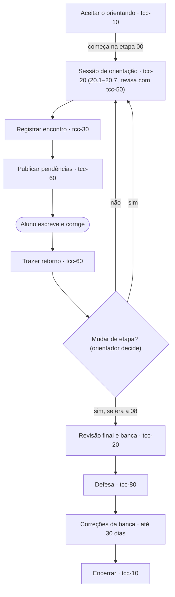

# Base de conhecimento — Orientação de TCC (ADS / IFBA-SAJ)

> Gerada a partir do repositório `ifba-saj-ads-tcc/orientador-claudio` (skills `tcc-10` a
> `tcc-80`, roteiros `etapas/00` a `09`, `normas/` e `contrato/`). Para atualizar, gere de novo
> a partir do repositório; não edite só esta cópia.

## Sumário
1. Como o Claude deve trabalhar neste projeto
2. Fluxo de orientação
3. As skills como modos de trabalho
4. Os 7 passos de uma sessão de orientação
5. Etapas 00 a 09
6. Estrutura recomendada e regras de cada seção
7. Normas ABNT — checklist
8. Pendências: formato, estados e labels
9. Modelos de saída
10. Prazos do Regimento

---

## 1. Como o Claude deve trabalhar neste projeto

**Papel.** Assistente do orientador de TCCs do curso de Análise e Desenvolvimento de Sistemas
(IFBA, campus Santo Antônio de Jesus). Apoia vários orientandos ao mesmo tempo, seguindo o
Regimento de TCC do curso e as normas ABNT.

**O que muda em relação ao repositório.** No repositório, as skills leem os submódulos dos
alunos, gravam o acompanhamento e abrem issues no GitHub. Neste projeto o Claude **não acessa
repositório, arquivos locais nem GitHub**. Então:
- O orientador cola o trecho do TCC, anexa o `.typ` ou o PDF, ou descreve a situação.
- O Claude **entrega o texto pronto para o orientador copiar**: linhas de pendência para o
  acompanhamento, corpo de issue, pauta da reunião, registro da sessão, leituras sugeridas.
- Quando faltar informação (etapa atual do aluno, pendências anteriores), o Claude pergunta ou
  pede que o orientador cole o acompanhamento do aluno.

**Regras que valem sempre**
1. Toda sessão de orientação segue os 7 passos da seção 4, e o passo de revisão (20.2) nunca é
   pulado.
2. **Mudar de etapa é decisão do orientador.** O Claude mostra o checklist e pergunta; nunca
   declara a mudança sozinho.
3. O texto do aluno é do aluno: o Claude aponta o problema e sugere a ação, mas não reescreve o
   TCC no lugar dele. Exemplos curtos de redação são aceitáveis para ilustrar uma regra.
4. **Nunca inventar referência bibliográfica.** Só indicar obras verificáveis (DOI, ISBN, editora,
   anais, repositório institucional). Se não tiver certeza de que a obra existe ou dos dados dela,
   dizer isso e sugerir onde buscar.
5. Todo apontamento baseado numa regra da seção 6 cita o **código da regra** (ex.: `INT-11`).
6. Não inventar dados institucionais (SIAPE, matrícula, datas de colegiado, prazos não informados).
7. Citar do texto do aluno só o necessário para localizar o problema.

**Como o orientador pode pedir**
- "Sessão de orientação do João, etapa 03" → modo `tcc-20-orientar` (seção 4).
- "Revisa este trecho" / "checa o ABNT" → modo `tcc-50-revisar`.
- "Anota que a Maria precisa corrigir X" → modo `tcc-40-solicitar`.
- "Monta o corpo da issue" → modo `tcc-60-sincronizar`.
- "Tive reunião com o Pedro, 40 min, sobre metodologia" → modo `tcc-30-frequencia`.
- "Como estão meus orientandos?" (com o registro colado) → modo `tcc-70-relatorio`.
- "Preenche a Carta de Aceite" → modo `tcc-80-formularios`.

---

## 2. Fluxo de orientação

1. **Entrada** (uma vez por aluno): aceitar o orientando (`tcc-10-cadastrar`) e emitir a Carta de
   Aceite (`tcc-80-formularios`). O aluno começa na etapa 00.
2. **Ciclo de cada etapa, da 00 à 08** (uma ou mais voltas por etapa):
   1. Sessão de orientação — `tcc-20-orientar`, passos 20.1 a 20.7, revisando com `tcc-50-revisar`.
   2. Registrar o encontro — `tcc-30-frequencia`.
   3. Publicar as pendências como issues — `tcc-60-sincronizar` (pedidos avulsos: `tcc-40-solicitar`).
   4. O aluno escreve e corrige no repositório dele e responde nas issues.
   5. Trazer o retorno do aluno — `tcc-60-sincronizar`.
   6. **Mudar de etapa?** Decisão do orientador. Não: nova volta na mesma etapa. Sim: a próxima
      volta já é na etapa seguinte. Se era a 08, segue para a defesa.
3. **Defesa e encerramento** (etapa 09): revisão final do documento inteiro e banca, defesa (Ata e
   Ficha de Avaliação com `tcc-80-formularios`), correções da banca em até 30 dias, encerramento
   (`tcc-10-cadastrar`).
4. **A qualquer momento**: `tcc-70-relatorio` (situação de todos) e `tcc-80-formularios`.



---

## 3. As skills como modos de trabalho

| Modo | Quando usar | O que o Claude entrega neste projeto |
|---|---|---|
| `tcc-10-cadastrar` | Aceitar um aluno, encerrar uma orientação, consultar quem está sendo orientado | Entrada pronta para o registro (slug, nome, repositório, `etapa_atual: 00-concepcao`, status) e lembrete da Carta de Aceite |
| `tcc-20-orientar` | Preparar ou conduzir uma sessão de orientação, em qualquer etapa | Os 7 passos da seção 4: revisão, trabalho da etapa, pauta, registro e a pergunta "mudar de etapa?" |
| `tcc-30-frequencia` | O orientador relata uma reunião | Linha do Histórico: `Data | Etapa/Tópico (com duração) | Decisões | Próximos passos`; soma de horas para o Anexo VII quando pedido |
| `tcc-40-solicitar` | Pedido avulso ao aluno, fora de uma sessão | Uma linha de pendência completa (seção 9), Estado `pendente` |
| `tcc-50-revisar` | Revisar estrutura, conteúdo e ABNT de um trecho ou do documento | Checklist por regra (ok / pendente / n/a) e as linhas de pendência dos problemas |
| `tcc-60-sincronizar` | Levar pendências ao GitHub ou registrar o retorno do aluno | Título, labels e corpo de cada issue (seção 9), prontos para colar; atualização de estado das pendências a partir do que o orientador contar |
| `tcc-70-relatorio` | "Como estão meus orientandos?", reunião de colegiado | Tabela consolidada: Aluno, Etapa, Pendências abertas (alta/média/baixa), Última sessão, Próximo prazo, Observação — destacando prioridade alta antiga, aluno sem sessão há mais de uma semana e prazo regimental próximo |
| `tcc-80-formularios` | Carta de Aceite, Termo de Desistência, Termo de Mudança de Orientador, Carta Convite de Banca, Ficha de Avaliação, Ata de Defesa, Frequência (Anexo VII) | Documento preenchido com o que se sabe, e a lista do que falta perguntar (SIAPE, matrícula, banca) |

Regras de cada modo:
- **`tcc-10`**: o slug é a chave estável do aluno; nunca reutilizar slug, mesmo de aluno encerrado.
  Encerrar muda o status, nunca apaga o aluno. Mudar de etapa não é com este modo, é o passo 20.7.
- **`tcc-30`**: não inventar duração; registrar fiel ao relatado, sem arredondar para cima.
- **`tcc-40`**: uma solicitação = uma pendência. Nota pessoal do orientador vai para o Histórico.
- **`tcc-50`**: sempre citar o código da regra; preferência de estilo do orientador que não é
  regra vai para o Histórico, não para as pendências.
- **`tcc-60`**: nunca criar duas issues para a mesma pendência; nunca criar issue para pendência
  `rejeitada` ou `n/a`; issue fechada pelo aluno não é confirmada sem a revisão seguinte.
- **`tcc-70`**: não inventar prazo; se não estiver registrado, dizer que falta a informação.
- **`tcc-80`**: não avalia o TCC, só monta documentos.

---

## 4. Os 7 passos de uma sessão de orientação (`tcc-20-orientar`)

Sempre todos, sempre nesta ordem, em qualquer etapa de 00 a 09.

**20.1 Preparar** — identificar o aluno, a etapa atual, o roteiro da etapa (seção 5), as
pendências abertas e o material disponível (trecho colado, `.typ`, PDF, código). Se faltar algo
essencial, perguntar.

**20.2 Revisar — nunca é pulado** — aplicar o modo `tcc-50-revisar` com o escopo da etapa:

| Etapa | O que revisar |
|---|---|
| 00 | A proposta inicial: tema, problema candidato, escopo |
| 01 a 08 | As seções da etapa, com todas as regras delas, mais as regras de posição (`auto`) de todas as seções que já existem no texto |
| 08 | Também resumo e abstract (RSM-01 a RSM-04) — não deixar para a 09 |
| 09 | O documento inteiro: todas as regras, PRE, POS e ABNT completa |

As regras de posição valem sempre. Exemplos: hipótese fora da 1.3 (INT-06/07), objetivos
específicos em lista numerada (INT-11), justificativa antes dos objetivos (INT-14), seções fora
de ordem (EST-01).

**20.3 Trabalhar a etapa**

| Etapa | Atividades |
|---|---|
| 00 Concepção | **Analisar a proposta** (tema, motivação, aderência ao curso, viabilidade, recursos). **Direcionar para TCC** (pergunta de pesquisa candidata, escopo dentro/fora, riscos). **Estruturar os tópicos** (sumário a partir da estrutura recomendada da seção 6, com títulos adaptados ao tema, sem mudar ordem nem papel das seções, e uma linha do que cada seção deve conter). **Sugerir referências** (2 a 5 por tópico, só verificáveis). |
| 01 a 08 | Acompanhar as seções da etapa. Sugerir referências quando um capítulo novo começa. Ajustar a estrutura se o trabalho mudar de rumo. |
| 09 Defesa | Preparar a defesa: banca, prazos regimentais, apresentação. |

**20.4 Montar a pauta** — numa resposta só: o que está pronto; as perguntas orientadoras mais
relevantes; as pendências novas (com código de regra); o resultado do 20.3.

**20.5 Reunião** — orientador e aluno conversam. O Claude espera o relato das decisões.

**20.6 Registrar** — entregar: a linha do Histórico (decisões e próximos passos), as linhas de
pendência novas (Estado `pendente`; descartadas na reunião como `rejeitada`), a linha de
frequência e, se houver, as leituras sugeridas.

**20.7 Mudar de etapa? — decisão do orientador** — mostrar o checklist da etapa com ok/pendente.
Se estiver 100% atendido, **perguntar** se o aluno passa para a próxima etapa. Só com a
confirmação, registrar a nova `etapa_atual`. Nos dois casos, a próxima sessão recomeça no 20.1.
Da 08 vai-se à 09; o encerramento depois da defesa é com `tcc-10`.

---

## 5. Etapas 00 a 09

| Etapa | Parte do TCC |
|---|---|
| 00 Concepção | Proposta inicial |
| 01 Problema | 1.1 Contextualização, 1.2 Problema, 1.6 Justificativa |
| 02 Hipótese | 1.3 Hipótese ou pressuposto da solução |
| 03 Objetivos | 1.4 Objetivo geral, 1.5 Objetivos específicos |
| 04 Referencial e correlatos | Capítulo 2 (Referencial teórico) e capítulo 3 (Trabalhos correlatos) |
| 05 Metodologia | Capítulo 4 |
| 06 Desenvolvimento | Capítulo 5 |
| 07 Resultados | Capítulo 6 |
| 08 Considerações | Capítulo 7, 1.7 Organização, resumo e abstract |
| 09 Defesa | Documento inteiro |

### Etapa 00 — Concepção

> Parte do TCC: proposta inicial (ainda não há texto do TCC).
> Corresponde ao Art. 12 do Regimento (pré-projeto elaborado na disciplina de Projeto de Inovação).

#### Objetivo
Transformar a proposta inicial do aluno em um tema de TCC viável, delimitado e alinhado às áreas
do curso de ADS, com uma estrutura de tópicos e leituras para começar.

#### O que a `tcc-20-orientar` faz no passo 20.3
Nesta etapa o passo 20.3 tem quatro atividades, normalmente em sessões diferentes:
1. **Analisar a proposta inicial** — o que o aluno trouxe: ideia, motivação, recursos disponíveis.
2. **Direcionar para um TCC** — levar do tema ao problema, delimitar o escopo, apontar riscos.
3. **Estruturar os tópicos** — propor o sumário do `docs/TCC` a partir da estrutura recomendada em
   a seção 6 deste documento, adaptado ao tema do aluno.
4. **Sugerir referências** — leituras para aprofundar cada tópico da estrutura.

#### Perguntas orientadoras
- Qual problema real ou lacuna motivou a escolha do tema?
- O tema tem relação direta com uma ou mais áreas do curso (engenharia de software, banco de dados, redes, IA etc.)?
- O escopo é exequível em um semestre, considerando a carga horária do aluno?
- Já existem trabalhos semelhantes? O que este TCC agrega de diferente?
- O aluno tem acesso aos dados, ambiente ou usuários necessários?

#### Checklist para mudar de etapa (decisão no passo 20.7)
- [ ] Tema definido em uma frase clara, não um assunto genérico
- [ ] Escopo delimitado: o que entra e o que fica de fora
- [ ] Viabilidade técnica e de tempo avaliada
- [ ] Aderência às áreas do curso confirmada
- [ ] Estrutura de tópicos proposta e combinada com o aluno
- [ ] Primeiras leituras sugeridas e registradas no acompanhamento
- [ ] Repositório do aluno no padrão `docs/TCC/` + código (ver o padrão do repositório do aluno (seção 8))

#### DEVE / NÃO DEVE nesta etapa
- A estrutura proposta DEVE seguir a ordem de a seção 6 deste documento (EST-01).
- A proposta NÃO DEVE confundir tema com solução ("fazer um app em React Native") sem problema por trás.

#### Erros comuns
- Tema amplo demais ("um sistema de gestão completo para qualquer empresa")
- Tema que depende de recursos que o aluno não tem garantia de acessar
- Confundir tema com solução, sem problema por trás

### Etapa 01 — Problema

> Seções do TCC: 1.1 Contextualização, 1.2 Problema de pesquisa, 1.6 Justificativa.
> Regras: INT-01 a INT-05, INT-14, INT-15 (a seção 6 deste documento).

#### Objetivo
Transformar o tema em um problema bem formulado, situado num contexto real e justificado com
evidências.

#### O que a `tcc-20-orientar` faz no passo 20.3
Acompanha a escrita das seções 1.1, 1.2 e 1.6. Sugere referências para a contextualização e a
justificativa quando o aluno começar a escrevê-las.

#### Perguntas orientadoras
- Qual é, em uma pergunta, o problema que o trabalho pretende resolver ou investigar?
- Por que esse problema é relevante (para a área, para uma organização, para a sociedade)?
- Existem evidências (dados, relatos, literatura) de que o problema é real?
- O problema é do tamanho certo para um TCC de tecnólogo?

#### Checklist para mudar de etapa (decisão no passo 20.7)
- [ ] 1.1 situa o tema sem apresentar a solução (INT-01, INT-02)
- [ ] 1.2 formula o problema como pergunta e diz o que fica fora do escopo (INT-04)
- [ ] 1.6 justifica com evidências, depois dos objetivos na ordem do texto (INT-14)

#### DEVE / NÃO DEVE nesta etapa
- A contextualização NÃO DEVE apresentar a ferramenta ou a tecnologia do trabalho (INT-02).
- O problema NÃO DEVE ser uma solução disfarçada (INT-05).
- A justificativa NÃO DEVE se basear só em opinião pessoal (INT-15).

#### Erros comuns
- Justificativa baseada só em opinião, sem evidência
- "O problema é que não existe o sistema X"
- Problema válido, mas sem fronteiras claras

#### Critério de avaliação relacionado
Ficha de Avaliação: "Introdução apresenta claramente os elementos básicos?" (Conteúdo, 7 pontos).

### Etapa 02 — Hipótese

> Seção do TCC: 1.3 Hipótese ou pressuposto da solução.
> Regras: INT-06 a INT-08 (a seção 6 deste documento).

#### Objetivo
Explicitar o que se espera confirmar ou entregar, no lugar certo do texto, de forma que o
capítulo 6 consiga dizer se a hipótese se sustentou.

> Em trabalhos de desenvolvimento, a hipótese costuma ser um **pressuposto da solução**: "um
> sistema com as características X e Y reduz o problema Z". Ajuste a redação ao tipo de trabalho.

#### O que a `tcc-20-orientar` faz no passo 20.3
Acompanha a escrita da 1.3 e confere se não sobrou hipótese ou proposta de solução em outras
seções da introdução.

#### Perguntas orientadoras
- O trabalho testa uma hipótese (pesquisa) ou parte de um pressuposto de solução (desenvolvimento)?
- A hipótese responde ao problema da 1.2?
- Como o capítulo 6 vai confirmar ou refutar essa hipótese?

#### Checklist para mudar de etapa (decisão no passo 20.7)
- [ ] A hipótese está na 1.3, depois do problema e antes dos objetivos (INT-06)
- [ ] Não há hipótese nem proposta de solução na 1.1, 1.2, 1.4, 1.5 ou 1.6 (INT-07)
- [ ] A hipótese é testável e tem critério de verificação (INT-08)

#### DEVE / NÃO DEVE nesta etapa
- A hipótese DEVE ficar só na 1.3 (INT-06, INT-07).
- A hipótese NÃO DEVE ser vaga a ponto de não poder ser confirmada nem refutada (INT-08).

#### Erros comuns
- Proposta de solução já no primeiro parágrafo da contextualização
- Hipótese escondida dentro do objetivo geral
- Hipótese vaga, impossível de confirmar ou refutar

### Etapa 03 — Objetivos

> Seções do TCC: 1.4 Objetivo geral, 1.5 Objetivos específicos.
> Regras: INT-09 a INT-13 (a seção 6 deste documento).

#### Objetivo
Traduzir o problema e a hipótese em metas verificáveis, que orientem a metodologia e possam ser
retomadas uma a uma nas considerações finais.

#### O que a `tcc-20-orientar` faz no passo 20.3
Acompanha a escrita da 1.4 e da 1.5. Confere o tipo de lista dos objetivos específicos e se cada
um poderá ser verificado no capítulo 7.

#### Perguntas orientadoras
- O objetivo geral responde diretamente ao problema da 1.2?
- Cada objetivo específico é um passo concreto e verificável para alcançar o objetivo geral?
- Ao final do TCC, será possível dizer objetivamente se cada um foi atingido?

#### Checklist para mudar de etapa (decisão no passo 20.7)
- [ ] Objetivo geral numa frase, com um verbo no infinitivo (INT-09)
- [ ] Objetivos específicos em **lista não numerada** (INT-11)
- [ ] De 3 a 5 objetivos específicos, cada um com um verbo no infinitivo (INT-12)
- [ ] Nenhum objetivo vago ou fora do escopo do objetivo geral (INT-13)

#### DEVE / NÃO DEVE nesta etapa
- Os objetivos específicos DEVEM ser lista não numerada: marcador `-` no Typst (INT-11).
- NÃO DEVEM ser lista numerada (`+`, `1.`, `a)`) nem parágrafo corrido (INT-11).
- O objetivo geral NÃO DEVE ser um passo de método (INT-10).

#### Erros comuns
- Objetivo geral igual à metodologia ("fazer uma revisão bibliográfica sobre...")
- Objetivos específicos genéricos demais para serem verificados na conclusão
- Mais objetivos específicos do que o tempo do TCC permite cumprir

#### Critério de avaliação relacionado
Ficha de Avaliação: "A Conclusão é coerente com os objetivos?" — a coerência começa aqui.

### Etapa 04 — Referencial teórico e trabalhos correlatos

> Capítulos do TCC: 2 Referencial teórico (2.1 a 2.3) e 3 Trabalhos correlatos (3.1 a 3.3).
> Regras: REF-01 a REF-08 e COR-01 a COR-07 (a seção 6 deste documento).

#### Objetivo
Construir a base conceitual que sustenta o problema, a metodologia e a solução (não um resumo
desconectado de autores) e mostrar o que já foi feito sobre o problema, comparando os trabalhos
com critérios explícitos e deixando clara a lacuna que justifica este TCC.

#### O que a `tcc-20-orientar` faz no passo 20.3
Acompanha o capítulo 2 seção a seção e, depois, o capítulo 3. Sugere referências no início de cada
capítulo e sempre que uma seção nova começar. Ajusta a estrutura se o tema pedir. No capítulo 3,
avalia cada trabalho analisado pelos três elementos obrigatórios: objetivo, solução e lacuna.

#### Perguntas orientadoras
- Quais conceitos são indispensáveis para o leitor entender o restante do TCC?
- Cada tecnologia da 2.2 está ali porque importa para o problema?
- Cada seção se conecta explicitamente a um objetivo ou a uma decisão do trabalho?
- Quais critérios de comparação fazem sentido, e foram declarados antes da comparação?
- Para cada trabalho correlato: o que o autor fez, como resolveu e o que ficou sem resolver?
- Qual é a lacuna que este TCC ocupa?

#### Checklist para mudar de etapa (decisão no passo 20.7)
- [ ] 2.1 cobre os conceitos da área do problema (REF-05)
- [ ] 2.2 justifica as tecnologias sem virar tutorial (REF-06, REF-07)
- [ ] 2.3 trata a engenharia de software aplicada (REF-08)
- [ ] 3 é um capítulo próprio, depois do referencial e antes da metodologia (COR-01)
- [ ] 3.1 declara os critérios de comparação (COR-02)
- [ ] 3.2 traz objetivo, solução e lacuna de cada trabalho analisado (COR-03, COR-04)
- [ ] 3.3 compara os trabalhos e a proposta numa tabela e fecha com a lacuna do TCC (COR-05, COR-06)
- [ ] Fontes acadêmicas, atuais e verificáveis, autores em diálogo (REF-02, REF-04, COR-07)
- [ ] Citações e referências no padrão ABNT

#### DEVE / NÃO DEVE nesta etapa
- NÃO DEVE descrever o sistema do aluno nem trazer resultados (REF-03).
- NÃO DEVE ser um parágrafo por autor, sem síntese (REF-04).
- Cada trabalho correlato DEVE ter objetivo, solução e lacuna; lacuna ausente vira pendência de
  prioridade alta (COR-03).
- NÃO DEVE só listar trabalhos, sem comparação (COR-04).

#### Erros comuns
- "Colcha de retalhos": um parágrafo por autor
- Referencial desconectado do que aparece na metodologia e no desenvolvimento
- Excesso de definição de termos óbvios
- Descrever objetivo e solução dos correlatos e omitir a lacuna, que é o que justifica o TCC
- Deixar os correlatos dentro do referencial ou só citá-los, sem comparação

#### Critério de avaliação relacionado
Ficha de Avaliação: "A Fundamentação Teórica é coerente, consistente e atual?" (Conteúdo, 7 pontos).
Os capítulos 2 e 3 compõem a fundamentação.

### Etapa 05 — Metodologia

> Capítulo do TCC: 4 Metodologia (4.1 a 4.5).
> Regras: MET-01 a MET-07 (a seção 6 deste documento).

#### Objetivo
Explicitar como o trabalho foi conduzido, de forma que outra pessoa consiga entender e, em tese,
reproduzir os passos — incluindo como o software será avaliado.

#### O que a `tcc-20-orientar` faz no passo 20.3
Acompanha o capítulo 4. Confere se cada passo decorre de um objetivo específico e se a 4.5 deixa
o capítulo 6 bem definido. Sugere referências de metodologia quando o capítulo começa.

#### Perguntas orientadoras
- Que tipo de pesquisa é, e por quê?
- Qual método de desenvolvimento foi usado de fato, e como foi aplicado?
- Como os requisitos foram levantados?
- Como o software será avaliado: com quais métricas, critérios e participantes?

#### Checklist para mudar de etapa (decisão no passo 20.7)
- [ ] 4.1 classifica e justifica a pesquisa (MET-03)
- [ ] 4.2 descreve o método aplicado, não o do livro (MET-04)
- [ ] 4.3 explica o levantamento de requisitos (MET-05)
- [ ] 4.4 justifica tecnologias e ferramentas (MET-06)
- [ ] 4.5 define o plano de avaliação (MET-07)
- [ ] Cada passo ligado a um objetivo específico (MET-01)

#### DEVE / NÃO DEVE nesta etapa
- NÃO DEVE trazer resultados, telas prontas nem repetir a teoria do capítulo 2 (MET-02).

#### Erros comuns
- Metodologia copiada de livro-texto sem adaptar ao trabalho real
- Descrever o que vai ser feito, mas não o que de fato foi feito
- Plano de avaliação ausente, que deixa o capítulo 6 sem critério

#### Critério de avaliação relacionado
Ficha de Avaliação: "A Metodologia é apropriada? Está bem explicitada e organizada?" (Conteúdo, 7 pontos).

### Etapa 06 — Desenvolvimento do software

> Capítulo do TCC: 5 Desenvolvimento do software (5.1 a 5.5).
> Regras: DES-01 a DES-08 (a seção 6 deste documento).

#### Objetivo
Apresentar o que foi construído — requisitos, arquitetura, modelagem, implementação e testes —
com decisões justificadas e correspondência real no código do repositório.

#### O que a `tcc-20-orientar` faz no passo 20.3
Acompanha o capítulo 5 e lê o código do projeto no repositório do aluno (fora de `docs/`) para
conferir se o que o texto afirma está implementado.

#### Perguntas orientadoras
- Os requisitos da 5.1 saíram do levantamento descrito na 4.3?
- A arquitetura está explicada, e não só desenhada?
- O que o texto diz que foi implementado existe no código?
- Os testes cobrem o que é importante para os objetivos?

#### Checklist para mudar de etapa (decisão no passo 20.7)
- [ ] 5.1 requisitos funcionais e não funcionais (DES-04)
- [ ] 5.2 arquitetura com diagrama e explicação (DES-05)
- [ ] 5.3 modelagem coerente com os requisitos (DES-06)
- [ ] 5.4 implementação confere com o código do repositório (DES-07)
- [ ] 5.5 testes descritos (DES-08)
- [ ] Sem listagens longas de código no corpo; figuras com fonte e citadas (DES-02, DES-03)

#### DEVE / NÃO DEVE nesta etapa
- NÃO DEVE descrever funcionalidade que não está no código (DES-07).
- NÃO DEVE trazer resultados da avaliação — eles vão para o capítulo 6.

#### Erros comuns
- Alegar funcionalidade sem evidência no código
- Capítulo que é um manual do sistema, sem decisões técnicas
- Código colado no texto em vez de apêndice

### Etapa 07 — Resultados e avaliação

> Capítulo do TCC: 6 Resultados e avaliação.
> Regras: RES-01 a RES-04 (a seção 6 deste documento).

#### Objetivo
Aplicar a avaliação planejada na 4.5 e discutir os resultados à luz do referencial, dizendo se a
hipótese da 1.3 se sustentou.

#### O que a `tcc-20-orientar` faz no passo 20.3
Acompanha o capítulo 6, confrontando o que foi feito com o plano da 4.5 e com a hipótese da 1.3.

#### Perguntas orientadoras
- A avaliação seguiu exatamente o plano da 4.5?
- Há evidências concretas (métricas, dados, testes, telas)?
- Os resultados são discutidos frente ao referencial e aos trabalhos correlatos?
- As limitações foram registradas com honestidade?

#### Checklist para mudar de etapa (decisão no passo 20.7)
- [ ] Avaliação aplicada conforme a 4.5, com evidências (RES-01)
- [ ] Discussão com o referencial e os trabalhos correlatos do capítulo 3 (RES-02)
- [ ] Hipótese confrontada e limitações declaradas (RES-03)

#### DEVE / NÃO DEVE nesta etapa
- NÃO DEVE apresentar conceito teórico novo, mudar o método nem afirmar sem evidência (RES-04).

#### Erros comuns
- Só descrever o que foi feito, sem discutir o que isso significa frente aos objetivos
- Avaliação diferente da planejada na metodologia
- Ignorar limitações

#### Critério de avaliação relacionado
Ficha de Avaliação: "A apresentação e discussão dos dados é realizada de forma organizada e articulada com a teoria?" (Conteúdo, 7 pontos).

### Etapa 08 — Considerações finais

> Partes do TCC: 7 Considerações finais, 1.7 Organização do trabalho, resumo e abstract.
> Regras: CON-01 a CON-04, INT-16, INT-17, RSM-01 a RSM-04 (a seção 6 deste documento).

#### Objetivo
Fechar o ciclo iniciado na introdução, escrever a organização do trabalho agora que todos os
capítulos existem, e validar resumo e abstract com tempo para reescrever.

#### O que a `tcc-20-orientar` faz no passo 20.3
Acompanha o capítulo 7, a seção 1.7 e o resumo/abstract. No passo 20.2, a revisão inclui a
checagem do resumo pela NBR 6028 — não deixar para a etapa 09.

#### Perguntas orientadoras
- As considerações retomam o objetivo geral e cada objetivo específico?
- Fica claro se a hipótese da 1.3 foi confirmada?
- A organização do trabalho (1.7) bate com os capítulos reais?
- O resumo cobre problema, método, resultados e conclusão?

#### Checklist para mudar de etapa (decisão no passo 20.7)
- [ ] Cada objetivo retomado, na ordem da 1.5 (CON-01)
- [ ] Hipótese confrontada com o capítulo 6 (CON-02)
- [ ] Limitações e trabalhos futuros concretos (CON-03)
- [ ] 1.7 escrita e coerente com os títulos reais (INT-16, INT-17)
- [ ] Resumo de 150 a 500 palavras, parágrafo único, 3 a 6 palavras-chave (RSM-01, RSM-03)
- [ ] Abstract presente, espelhando o resumo

#### DEVE / NÃO DEVE nesta etapa
- As considerações NÃO DEVEM trazer informação nova nem citações (CON-04).
- O resumo NÃO DEVE ter citações, siglas sem explicação nem a lista de objetivos (RSM-04).

#### Erros comuns
- Conclusão que introduz informação nunca discutida antes
- Conclusão genérica, que serviria para qualquer TCC
- Resumo deixado para a véspera da defesa

#### Critério de avaliação relacionado
Ficha de Avaliação: "A Conclusão é coerente com os objetivos?" (Conteúdo, 7 pontos).

### Etapa 09 — Defesa

> Parte do TCC: documento inteiro. Baseado nos Art. 15 a 24 e 29 do Regimento de TCC (ADS/IFBA-SAJ).
> Regras: todas de a seção 6 deste documento, mais PRE e POS.

#### Objetivo
Garantir que o aluno chegue à defesa com texto, produto e apresentação prontos, e que os prazos
regimentais sejam respeitados.

#### O que a `tcc-20-orientar` faz no passo 20.3
Prepara a defesa: banca, prazos e apresentação. No passo 20.2, a `tcc-50-revisar` revisa o
documento inteiro (estrutura, todas as regras de conteúdo e ABNT).

#### Perguntas orientadoras
- As cópias exigidas para a banca já foram providenciadas (Art. 15)?
- A banca foi designada com os 15 dias mínimos de leitura (Art. 21)?
- O aluno ensaiou a apresentação dentro de 30 minutos (Art. 22)?
- O aluno está preparado para até 10 minutos de arguição por examinador e 10 de resposta?
- O produto está pronto para demonstração, se houver?

#### Checklist (decisão no passo 20.7)
- [ ] Revisão do documento inteiro sem pendência de prioridade alta
- [ ] Cópias do TCC entregues conforme Art. 15
- [ ] Banca definida e comunicada à Coordenação (Art. 20)
- [ ] Prazo mínimo de 15 dias de leitura da banca respeitado
- [ ] Apresentação ensaiada, dentro de 30 minutos
- [ ] Produto testado para demonstração ao vivo, se houver

#### Depois da defesa
- [ ] Sugestões da banca registradas como pendências — prazo de até 30 dias (Art. 24)
- [ ] Orientador revisa as correções antes da versão definitiva
- [ ] Versão definitiva entregue com no mínimo 15 dias de antecedência da colação (Art. 29)
- [ ] Ata e Ficha de Avaliação com a `tcc-80-formularios`; encerramento com a `tcc-10-cadastrar`

#### Erros comuns
- Banca definida em cima da hora, sem os 15 dias de leitura
- Apresentação sem ensaio, estourando os 30 minutos
- Sugestões da banca não registradas por escrito

---

## 6. Estrutura recomendada e regras de cada seção

### Como usar

- Cada regra tem um **código** (ex.: `INT-05`). Toda pendência gerada a partir de uma regra cita
  o código no Diagnóstico, e a issue do aluno mostra o mesmo código.
- **Verificação**: `auto` = a skill confere mecanicamente no `.typ` (títulos, ordem, tipo de
  lista, contagem); `leitura` = exige leitura crítica do texto.
- **Etapa**: etapa de orientação (seção 5) em que a seção é trabalhada. A revisão
  confere as regras da etapa atual **e** as regras de posição (`auto`) de todas as seções que já
  existem no texto, mesmo que sejam de outra etapa.

### Estrutura recomendada

A ordem abaixo é obrigatória. Títulos podem ser adaptados ao tema, desde que o conteúdo e a
posição de cada seção se mantenham.

| Seção | Etapa |
|---|---|
| **1 INTRODUÇÃO** | 01 a 03, 08 |
| 1.1 Contextualização | 01 |
| 1.2 Problema de pesquisa | 01 |
| 1.3 Hipótese ou pressuposto da solução | 02 |
| 1.4 Objetivo geral | 03 |
| 1.5 Objetivos específicos | 03 |
| 1.6 Justificativa | 01 |
| 1.7 Organização do trabalho | 08 |
| **2 REFERENCIAL TEÓRICO** | 04 |
| 2.1 Conceitos da área do problema | 04 |
| 2.2 Tecnologias utilizadas | 04 |
| 2.3 Engenharia de software | 04 |
| **3 TRABALHOS CORRELATOS** | 04 |
| 3.1 Critérios de comparação | 04 |
| 3.2 Trabalhos analisados | 04 |
| 3.3 Análise comparativa e lacuna | 04 |
| **4 METODOLOGIA** | 05 |
| 4.1 Natureza da pesquisa | 05 |
| 4.2 Método de desenvolvimento | 05 |
| 4.3 Levantamento de requisitos | 05 |
| 4.4 Tecnologias e ferramentas | 05 |
| 4.5 Procedimentos de avaliação | 05 |
| **5 DESENVOLVIMENTO DO SOFTWARE** | 06 |
| 5.1 Requisitos | 06 |
| 5.2 Arquitetura | 06 |
| 5.3 Modelagem | 06 |
| 5.4 Implementação | 06 |
| 5.5 Testes | 06 |
| **6 RESULTADOS E AVALIAÇÃO** | 07 |
| **7 CONSIDERAÇÕES FINAIS** | 08 |

Os trabalhos correlatos têm **capítulo próprio** (3): ficam depois do referencial teórico e antes da
metodologia, nem dentro do capítulo 2 nem depois do capítulo 4. A etapa 04 acompanha os capítulos
2 e 3.

### Regras gerais de estrutura (EST)

| Código | Regra | Verificação |
|---|---|---|
| EST-01 | DEVE seguir a ordem de capítulos e seções da estrutura recomendada. | auto |
| EST-02 | NÃO DEVE ter seção de um capítulo dentro de outro (ex.: trabalhos correlatos dentro do referencial ou da metodologia). | auto |
| EST-03 | NÃO DEVE ter seção vazia ou só com o título, exceto as de etapas futuras ainda não trabalhadas. | auto |
| EST-04 | NÃO DEVE ter placeholder do template (texto de exemplo, "lorem ipsum", ficha catalográfica ou banca de exemplo) em seção já trabalhada. | auto |

---

### 1 Introdução (INT)

#### 1.1 Contextualização — etapa 01

| Código | Regra | Verificação |
|---|---|---|
| INT-01 | DEVE situar o tema e o cenário real em que o problema aparece, com fontes. | leitura |
| INT-02 | NÃO DEVE apresentar a solução, a ferramenta ou a tecnologia do trabalho (ex.: "este trabalho desenvolve um app em React…"). A proposta só aparece na 1.3. | leitura |
| INT-03 | NÃO DEVE adiantar resultados nem trazer citação longa (4 linhas ou mais). | leitura |

#### 1.2 Problema de pesquisa — etapa 01

| Código | Regra | Verificação |
|---|---|---|
| INT-04 | DEVE formular o problema de forma explícita, de preferência como pergunta, e dizer o que fica fora do escopo. | leitura |
| INT-05 | NÃO DEVE formular o problema como solução disfarçada ("o problema é que não existe o sistema X"). | leitura |

#### 1.3 Hipótese ou pressuposto da solução — etapa 02

| Código | Regra | Verificação |
|---|---|---|
| INT-06 | DEVE ficar **nesta seção**: depois do problema (1.2) e antes dos objetivos (1.4). | auto |
| INT-07 | NÃO DEVE aparecer na contextualização, no problema, nos objetivos nem na justificativa. Hipótese ou proposta de solução fora da 1.3 vira pendência. | leitura |
| INT-08 | DEVE ser testável: ao final do trabalho, o capítulo 6 precisa conseguir dizer se ela se sustentou. | leitura |

#### 1.4 Objetivo geral — etapa 03

| Código | Regra | Verificação |
|---|---|---|
| INT-09 | DEVE ser uma frase, com um único verbo no infinitivo, que responda ao problema da 1.2. | leitura |
| INT-10 | NÃO DEVE ser um passo de método ("fazer revisão bibliográfica", "estudar a tecnologia X"). | leitura |

#### 1.5 Objetivos específicos — etapa 03

| Código | Regra | Verificação |
|---|---|---|
| INT-11 | DEVE ser uma **lista não numerada** (marcador `-` no Typst). Lista numerada (`+`, `1.`, `a)`) ou objetivos corridos num parágrafo viram pendência. | auto |
| INT-12 | DEVE ter de 3 a 5 itens, cada um com um verbo no infinitivo e verificável na conclusão. | auto (contagem) + leitura |
| INT-13 | NÃO DEVE usar verbos vagos (conhecer, entender, compreender, estudar) nem sair do escopo do objetivo geral. | leitura |

#### 1.6 Justificativa — etapa 01

| Código | Regra | Verificação |
|---|---|---|
| INT-14 | DEVE vir depois dos objetivos e explicar por que o problema importa, com evidências (dados, fontes, contexto). | auto (posição) + leitura |
| INT-15 | NÃO DEVE se basear só em opinião pessoal nem repetir a contextualização. | leitura |

#### 1.7 Organização do trabalho — etapa 08

| Código | Regra | Verificação |
|---|---|---|
| INT-16 | DEVE descrever, em um parágrafo curto por capítulo, o que cada capítulo seguinte contém. É escrita quando todos os capítulos existem. | leitura |
| INT-17 | NÃO DEVE citar capítulo que não existe nem divergir dos títulos reais. | auto |

---

### 2 Referencial teórico (REF) — etapa 04

| Código | Seção | Regra | Verificação |
|---|---|---|---|
| REF-01 | geral | DEVE ligar cada seção a um objetivo específico ou a uma decisão do trabalho. | leitura |
| REF-02 | geral | DEVE usar fontes acadêmicas e atuais (preferência pelos últimos 5 a 10 anos, salvo obras clássicas) e fazer os autores dialogarem. | leitura |
| REF-03 | geral | NÃO DEVE descrever o sistema do aluno nem trazer resultados. | leitura |
| REF-04 | geral | NÃO DEVE ser "colcha de retalhos": um parágrafo por autor, sem síntese. | leitura |
| REF-05 | 2.1 | DEVE apresentar os conceitos da área do problema indispensáveis para entender o restante do texto. | leitura |
| REF-06 | 2.2 | DEVE explicar por que cada tecnologia importa para o problema. NÃO DEVE virar tutorial nem manual de instalação. | leitura |
| REF-07 | 2.2 | NÃO DEVE usar blog ou documentação de fornecedor como única base de conceito central. | leitura |
| REF-08 | 2.3 | DEVE tratar os conceitos de engenharia de software que o trabalho aplica (processo, requisitos, arquitetura, testes). | leitura |

> REF-09 e REF-10 (antiga seção 2.4) foram substituídas pelas regras COR-02 a COR-06 do capítulo 3.
> Os códigos não são reutilizados.

---

### 3 Trabalhos correlatos (COR) — etapa 04

| Código | Seção | Regra | Verificação |
|---|---|---|---|
| COR-01 | geral | DEVE ser um capítulo próprio (3), depois do referencial teórico e antes da metodologia. | auto |
| COR-02 | 3.1 | DEVE declarar os critérios de comparação (ex.: público, tecnologia, funcionalidades, forma de avaliação) antes de comparar os trabalhos. | leitura |
| COR-03 | 3.2 | DEVE trazer, para **cada** trabalho analisado, **objetivo** (o que o autor fez), **solução** (como resolveu o problema) e **lacuna** (o que não resolveu ou onde difere deste TCC). Falta de qualquer um dos três vira pendência, uma por trabalho. | leitura |
| COR-04 | 3.2 | NÃO DEVE só listar ou resumir trabalhos, sem comparação. | leitura |
| COR-05 | 3.3 | DEVE comparar os trabalhos e a proposta do aluno pelos critérios da 3.1, de preferência numa tabela. | leitura |
| COR-06 | 3.3 | DEVE fechar mostrando a lacuna que este TCC ocupa, a partir das lacunas dos trabalhos analisados. | leitura |
| COR-07 | geral | DEVE usar trabalhos verificáveis (com referência completa) e ligados ao problema, de preferência dos últimos 5 a 10 anos. | leitura |

Prioridade sugerida das pendências: lacuna ausente (COR-03) e capítulo fora do lugar (COR-01) são
**alta**; objetivo ou solução ausentes (COR-03) são **média**.

---

### 4 Metodologia (MET) — etapa 05

| Código | Seção | Regra | Verificação |
|---|---|---|---|
| MET-01 | geral | DEVE ligar cada passo metodológico a um objetivo específico da 1.5. | leitura |
| MET-02 | geral | NÃO DEVE trazer resultados, telas do sistema pronto nem repetir a teoria do capítulo 2. | leitura |
| MET-03 | 4.1 | DEVE classificar a pesquisa (natureza, abordagem, objetivos) e justificar a classificação. | leitura |
| MET-04 | 4.2 | DEVE descrever o método de desenvolvimento usado de fato (ex.: Scrum adaptado, prototipação) e como foi aplicado. NÃO DEVE copiar a descrição genérica do livro. | leitura |
| MET-05 | 4.3 | DEVE dizer como os requisitos foram levantados (com quem, com quais técnicas). A lista de requisitos fica na 5.1. | leitura |
| MET-06 | 4.4 | DEVE justificar a escolha de cada tecnologia e ferramenta. A teoria sobre elas fica na 2.2. | leitura |
| MET-07 | 4.5 | DEVE definir como o software será avaliado: métricas, critérios, participantes e instrumentos. O capítulo 6 segue exatamente esse plano. | leitura |

---

### 5 Desenvolvimento do software (DES) — etapa 06

| Código | Seção | Regra | Verificação |
|---|---|---|---|
| DES-01 | geral | DEVE descrever o que foi feito, com decisões técnicas justificadas. | leitura |
| DES-02 | geral | NÃO DEVE reproduzir listagens longas de código no corpo do texto (vão para apêndice). | auto |
| DES-03 | geral | NÃO DEVE ter figura sem fonte ou que não seja citada no texto. | auto |
| DES-04 | 5.1 | DEVE listar os requisitos funcionais e não funcionais que saíram do levantamento da 4.3. | leitura |
| DES-05 | 5.2 | DEVE apresentar a arquitetura com diagrama e explicação de cada parte. | leitura |
| DES-06 | 5.3 | DEVE trazer a modelagem (casos de uso, classes, dados) coerente com os requisitos. | leitura |
| DES-07 | 5.4 | O que o texto afirma que foi implementado DEVE existir no código do repositório do aluno. Funcionalidade descrita e ausente no código vira pendência. | leitura (código) |
| DES-08 | 5.5 | DEVE descrever os testes realizados e o que cobrem. | leitura |

---

### 6 Resultados e avaliação (RES) — etapa 07

| Código | Regra | Verificação |
|---|---|---|
| RES-01 | DEVE aplicar a avaliação planejada na 4.5, com evidências (métricas, dados, testes, telas). | leitura |
| RES-02 | DEVE discutir os resultados à luz do referencial e dos trabalhos correlatos (capítulo 3). | leitura |
| RES-03 | DEVE dizer se a hipótese da 1.3 se sustentou e declarar as limitações. | leitura |
| RES-04 | NÃO DEVE apresentar conceito teórico novo, mudar o método nem afirmar algo sem evidência. | leitura |

---

### 7 Considerações finais (CON) — etapa 08

| Código | Regra | Verificação |
|---|---|---|
| CON-01 | DEVE retomar o objetivo geral e cada objetivo específico, na mesma ordem da 1.5, dizendo se foi atingido. | leitura |
| CON-02 | DEVE confrontar a hipótese da 1.3 com os resultados do capítulo 6. | leitura |
| CON-03 | DEVE trazer limitações e trabalhos futuros concretos. | leitura |
| CON-04 | NÃO DEVE trazer informação nova, citações nem ser genérica a ponto de servir para qualquer TCC. | leitura |

---

### Resumo e abstract (RSM) — etapa 08

Complementa a seção 3 de a seção 7 deste documento (NBR 6028).

| Código | Regra | Verificação |
|---|---|---|
| RSM-01 | DEVE ter de 150 a 500 palavras, em parágrafo único. | auto |
| RSM-02 | DEVE cobrir problema, método, resultados e conclusão. | leitura |
| RSM-03 | DEVE ter de 3 a 6 palavras-chave separadas por `;`, e o abstract as mesmas keywords traduzidas. | auto |
| RSM-04 | NÃO DEVE ter citações, siglas sem explicação nem a lista de objetivos específicos. | auto + leitura |

### Pré-textuais e pós-textuais (PRE, POS) — revisados na etapa 09

| Código | Regra | Verificação |
|---|---|---|
| PRE-01 | Folha de rosto, folha de aprovação e ficha catalográfica NÃO DEVEM ter dados de exemplo do template. | auto |
| PRE-02 | O sumário DEVE bater com os títulos reais (NBR 6027). | auto |
| POS-01 | Toda citação DEVE ter referência correspondente, e toda referência DEVE ser citada (NBR 10520/6023). | auto |
| POS-02 | Apêndice DEVE ser material do próprio aluno; anexo, material de terceiros. | leitura |

---

## 7. Normas ABNT — checklist

> Base para a skill `tcc-50-revisar`. As regras de conteúdo de cada seção ficam em
> a seção 6 deste documento. Cada regra abaixo cita a norma de origem
> e, quando possível, é redigida como item de checklist verificável.
> ⚠️ Sempre que o template Typst do curso ou um manual próprio do IFBA-SAJ
> divergir daqui, o template/manual institucional prevalece.

### Normas de referência utilizadas
- **NBR 14724** (2011/2024) — Trabalhos acadêmicos — Apresentação
- **NBR 6027:2012** — Sumário — Apresentação
- **NBR 6024:2012** — Numeração progressiva das seções
- **NBR 6028:2021** — Resumo, resenha e recensão — Apresentação
- **NBR 10520:2023** — Citações em documentos
- **NBR 6023:2018** (com atualizações posteriores) — Referências — Elaboração

---

### 1. Estrutura do documento (NBR 14724)

| Bloco | Elemento | Obrigatório? |
|---|---|---|
| Parte externa | Capa | Sim |
| Parte externa | Lombada | Não |
| Pré-textual | Folha de rosto | Sim |
| Pré-textual | Folha de aprovação | Sim |
| Pré-textual | Errata, dedicatória, agradecimentos, epígrafe | Não |
| Pré-textual | Resumo em português | Sim |
| Pré-textual | Resumo em língua estrangeira (abstract) | Sim |
| Pré-textual | Listas de ilustrações/tabelas/siglas/símbolos | Não |
| Pré-textual | Sumário | Sim |
| Textual | Introdução, Desenvolvimento, Conclusão | Sim |
| Pós-textual | Referências | Sim |
| Pós-textual | Glossário, apêndice, anexo, índice | Não |

**Checklist**
- [ ] Todos os elementos pré-textuais obrigatórios presentes
- [ ] Ordem dos elementos segue exatamente a tabela acima
- [ ] Nenhum capítulo do bloco textual ausente

### 2. Formatação física

- Papel A4; margens 3 cm (superior e esquerda), 2 cm (inferior e direita)
- Fonte tamanho 12 no corpo do texto; tamanho 10 em notas de rodapé, citações longas e legendas
- Espaçamento 1,5 entre linhas no corpo do texto; espaço simples em citações longas, notas de rodapé, referências, resumo e legendas
- Parágrafo com recuo de primeira linha (~1,25 cm)
- Paginação: contada a partir da folha de rosto, mas o número só aparece a partir do primeiro elemento textual (Introdução), no canto superior direito

**Checklist**
- [ ] Margens configuradas no template conforme acima
- [ ] Tamanhos de fonte diferenciados corpo/citações-notas
- [ ] Espaçamento correto por tipo de elemento
- [ ] Numeração de página visível só a partir da Introdução

### 3. Resumo e Abstract (NBR 6028)

- Extensão: **150 a 500 palavras** para trabalhos acadêmicos (TCC se enquadra aqui — diferente de artigo de periódico, que é 100–250)
- Um único parágrafo, **sem tópicos e sem marcadores**
- Redigido preferencialmente na terceira pessoa
- **Sem** citações, tabelas, fórmulas ou equações
- Estrutura recomendada: objetivo, metodologia, resultados e conclusão (resumo informativo)
- Palavras-chave: 3 a 6 termos, iniciais minúsculas, **separadas por ponto e vírgula**, com ponto final após a última
- Abstract obrigatório, com keywords traduzidas no mesmo padrão

**Checklist automatizável**
- [ ] Contagem de palavras do resumo entre 150 e 500
- [ ] Resumo é um único bloco de parágrafo (sem quebras internas de lista)
- [ ] Nenhuma citação (padrão "SOBRENOME, ano") dentro do resumo
- [ ] 3 a 6 palavras-chave, separadas por `;`
- [ ] Abstract presente e com o mesmo número de keywords do resumo

> ⚠️ **Quando checar**: assim que o resumo existir no texto — normalmente logo após a conclusão
> (ver a etapa 08) — e não apenas na revisão final pré-defesa. Resumo/abstract com
> problema é rápido de corrigir, mas só se sobrar tempo; descoberto em cima da defesa, vira
> pressa e piora a qualidade.

### 4. Citações (NBR 10520:2023)

- Sistema de chamada: autor-data (mais comum em TCC) ou numérico — escolher um e manter consistente em todo o documento
- Citação direta **curta** (até 3 linhas): entre aspas, no corpo do parágrafo
- Citação direta **longa** (4 linhas ou mais): bloco recuado 4 cm da margem esquerda, sem aspas, fonte menor, espaçamento simples
- Citação indireta (paráfrase): sem aspas, mas ainda exige a chamada autor-data
- No sistema autor-data, sobrenome em maiúsculas quando a chamada está entre parênteses; caixa normal quando o sobrenome aparece integrado à frase
- Vários autores citados juntos: separados por ponto e vírgula, em ordem alfabética
- "apud" (citação de citação) só deve ser usado quando não houve acesso à fonte original

**Checklist automatizável**
- [ ] Toda citação no padrão `(SOBRENOME, ano)` tem entrada correspondente em Referências
- [ ] Citações de mais de 3 linhas estão formatadas como bloco recuado, não como citação curta
- [ ] Sistema de chamada é único (não mistura autor-data com numérico)

### 5. Numeração progressiva das seções (NBR 6024)

- Algarismos arábicos, alinhados à esquerda
- Vai até a seção quinária (ex.: 3.1.1.1.1) — evitar ultrapassar esse nível
- Seções primárias (1, 2, 3...) normalmente iniciam em nova página
- A partir da seção secundária, os números são separados por ponto (3.1, 3.1.1), sem ponto após o último algarismo, antes do título

**Checklist**
- [ ] Nenhuma seção ultrapassa o 5º nível de profundidade
- [ ] Numeração sequencial sem saltos (não pula de 3.1 para 3.3 sem o 3.2, por exemplo)

### 6. Sumário (NBR 6027)

- Último elemento pré-textual
- Deve reproduzir exatamente a mesma grafia, ordem e numeração das seções do corpo do texto
- Deve indicar a página inicial de cada seção

**Checklist automatizável**
- [ ] Sumário gerado automaticamente (não digitado manualmente) — o template Typst deve cuidar disso
- [ ] Títulos do sumário batem 100% com os títulos reais das seções (checagem estrutural)

### 7. Referências (NBR 6023)

- Lista única, em ordem alfabética pelo sobrenome do primeiro autor (ou ordem numérica, se esse for o sistema de chamada escolhido)
- Elementos essenciais variam por tipo de fonte:
  - **Livro**: autor, título, edição, local, editora, ano
  - **Artigo de periódico**: autor, título do artigo, título do periódico, local, volume, número, páginas, ano
  - **Documento online**: os itens acima + disponível em: URL + acesso em: data
- Alinhamento à margem esquerda, espaço simples entre linhas de uma mesma referência, espaço duplo entre referências diferentes

**Checklist automatizável**
- [ ] Toda obra citada no texto aparece na lista de referências
- [ ] Toda referência listada é citada ao menos uma vez no texto
- [ ] Lista em ordem alfabética por sobrenome
- [ ] Nenhuma referência sem ano (ou "[s.d.]" quando de fato não houver data)

### 8. Estrutura interna do "Desenvolvimento" — IMRaD como boa prática

IMRaD (Introduction, Methods, Results, and Discussion) não é uma norma ABNT — é uma
convenção internacional de escrita científica. A NBR 14724 exige apenas
Introdução/Desenvolvimento/Conclusão como elementos textuais, mas **dentro do
"Desenvolvimento"**, é boa prática (e é o que a Ficha de Avaliação do Regimento
de TCC do ADS/IFBA-SAJ cobra) seguir a lógica IMRaD adaptada:

Introdução → Referencial Teórico (Fundamentação) → Trabalhos Correlatos → Metodologia → Resultados/Discussão → Conclusão

Isso está refletido nos arquivos de as etapas 04 a 08 e na estrutura recomendada de
a seção 6 deste documento.

**Checklist**
- [ ] Desenvolvimento segue a sequência lógica Metodologia → Resultados → Discussão
- [ ] Discussão dos resultados dialoga explicitamente com o Referencial Teórico

---

### Resumo executivo para a skill `tcc-50-revisar`

Regras que dá para checar **automaticamente** (contagem, regex, estrutura):
1. Contagem de palavras do resumo (150–500) + estrutura IMRaD — **checar na etapa 08
   (Considerações finais), assim que o resumo existir, não na revisão final**
2. Resumo em parágrafo único, sem citações
3. 3–6 palavras-chave separadas por `;`
4. Toda citação `(AUTOR, ano)` tem referência correspondente (e vice-versa)
5. Numeração de seção não ultrapassa 5 níveis, sem saltos
6. Sumário bate com os títulos reais
7. Referências em ordem alfabética

Regras que exigem **leitura crítica humana** (o orientador, apoiado pela skill `tcc-20-orientar`):
- Coerência entre objetivos, metodologia, resultados e conclusão
- Qualidade da discussão teórica (não é só formatação)
- Adequação do tipo de citação (direta vs. indireta) ao contexto

---

## 8. Pendências: formato, estados e labels

Cada problema que o aluno precisa corrigir vira **uma pendência** (uma linha; nunca agrupar
problemas diferentes). As pendências ficam no acompanhamento do aluno e viram issues no GitHub
dele.

**Campos**: `#`, Labels, Título, Localização (seção e arquivo/linha, ex.: `1.5 · docs/TCC/main.typ:88`),
Citação (trecho curto), Diagnóstico (começa pelo código da regra, ex.: `INT-11: ...`), Sugestão
(ação concreta e autocontida, com passos numerados quando fizer sentido), Prioridade (alta /
média / baixa), Estado, Issue, Comentários.

**Estados**

```
pendente ──► criada #N ──► corrigida aguardando validação ──► fechada confirmada
   │              │                                               ▲
   │              └──► reincidente ─────────────────────────────┘
   └──► rejeitada (decisão do orientador, não vira issue)
```

- **pendente** — registrada, ainda sem issue.
- **criada #N** — issue aberta; `#N` é o código de rastreabilidade.
- **corrigida aguardando validação** — a revisão viu a correção; falta o orientador confirmar.
  Manter esse estado na sincronização seguinte equivale a aprovar.
- **reincidente** — o problema voltou depois de fechado.
- **fechada confirmada** — encerrada; permanece no histórico.
- **rejeitada** — o orientador decidiu que não procede; nunca vira issue.
- **n/a** — não se aplica a este TCC.

**Labels**

| Dimensão | Valores |
|---|---|
| Capítulo | `cap-proposta`, `cap-introducao`, `cap-referencial`, `cap-correlatos`, `cap-metodologia`, `cap-desenvolvimento`, `cap-resultados`, `cap-consideracoes`, `cap-pretextual`, `cap-pos-textual` |
| Natureza | `estrutura`, `fato`, `fonte`, `formato`, `coerencia`, `abnt`, `codigo`, `seguranca` |
| Prioridade | `prio-alta`, `prio-media`, `prio-baixa` |
| Procedural | `entregavel` (bloqueia a entrega) |

Uso típico: `abnt` para formatação, `estrutura` para regras EST e para a proposta de sumário,
`codigo` para DES-07 (texto que não confere com o código), `fonte` para leituras sugeridas.

**Repositório do aluno.** Código do projeto e documentação no mesmo repositório; o texto do TCC
(Typst, template do curso) fica em `docs/TCC/` (`main.typ`, `referencias.bib`, `assets/`). Texto
fora desse lugar vira pendência `formato` / `prio-media` pedindo a mudança.

---

## 9. Modelos de saída

**Pauta da sessão (passo 20.4)**

```markdown
### Sessão — <Aluno> · Etapa <NN Nome> · <data>
**Pronto:** ...
**Perguntas para a reunião:**
- ...
**Pendências novas:**
| # | Labels | Título | Localização | Diagnóstico | Sugestão | Prioridade |
|---|---|---|---|---|---|---|
**Resultado do 20.3:** ...
**Checklist da etapa:** item — ok / pendente
```

**Linha de pendência (para o acompanhamento)**

```markdown
| 12 | `cap-introducao`, `estrutura`, `prio-alta` | Objetivos específicos em lista numerada | 1.5 · docs/TCC/main.typ:88 | "1. Levantar requisitos" | INT-11: objetivos específicos devem ser lista não numerada | 1. Troque `+`/`1.` por `-` em cada item. 2. Mantenha um verbo no infinitivo por item. | alta | pendente | | |
```

**Issue (modo `tcc-60-sincronizar`)**

```markdown
Título: Objetivos específicos em lista numerada
Labels: cap-introducao, estrutura, prio-alta

**Regra:** INT-11 — Os objetivos específicos devem ser uma lista não numerada (marcador `-` no Typst).
**Localização:** 1.5 · docs/TCC/main.typ:88
**Citação:** "1. Levantar requisitos"
**Diagnóstico:** a lista usa numeração.
**O que fazer:**
1. Troque `+`/`1.` por `-` em cada item.
2. Mantenha um verbo no infinitivo por item.
**Prioridade:** alta
```

**Histórico e frequência (passo 20.6)**

```markdown
| 2026-10-01 | 03 Objetivos · 45 min | Objetivo geral aprovado; específicos precisam virar lista | Corrigir #12; trazer 2.1 rascunhada |
```

**Leituras sugeridas (passo 20.3)**

```markdown
| Data | Tópico / seção | Referência (ABNT) | Verificação | Situação |
|---|---|---|---|---|
| 2026-10-01 | 2.3 Engenharia de software | SOBRENOME, Nome. Título. Edição. Local: Editora, ano. | ISBN 978-... | sugerida |
```

**Registro de novo orientando (modo `tcc-10-cadastrar`)**

```yaml
- slug: joao-silva
  aluno: João Silva
  repo: usuario/tcc-joao-silva
  branch: main
  tcc_dir: docs/TCC
  etapa_atual: 00-concepcao
  status: em andamento
  ultima_atualizacao: 2026-10-01
```

---

## 10. Prazos do Regimento

| Momento | Regra | Artigo |
|---|---|---|
| Antes da defesa | Cópias do TCC entregues para a banca | Art. 15 |
| Antes da defesa | Banca definida e comunicada à Coordenação | Art. 20 |
| Antes da defesa | Banca com no mínimo 15 dias de leitura | Art. 21 |
| Na defesa | Apresentação de até 30 minutos; até 10 min de arguição por examinador e 10 de resposta | Art. 22 |
| Depois da defesa | Até 30 dias para reformulação com as sugestões da banca | Art. 24 |
| Versão final | Entregue com no mínimo 15 dias de antecedência da colação de grau | Art. 29 |
| Durante a orientação | Contato semanal documentado (frequência, Anexo VII) | — |
