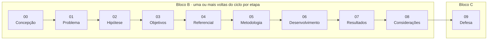
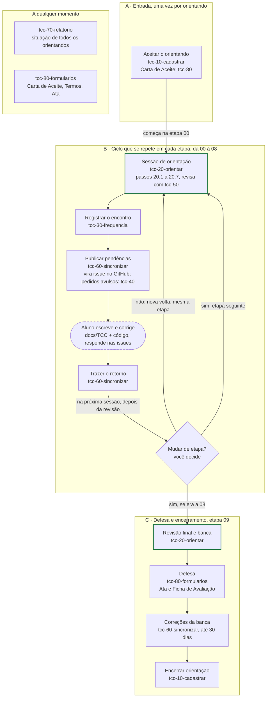
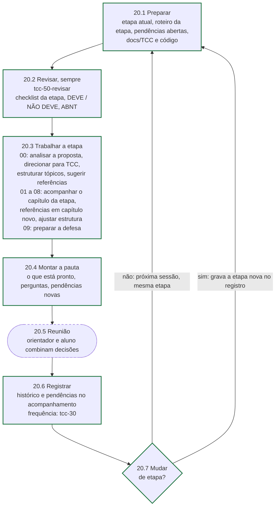

# Fluxo de uso das skills

> Versão HTML, com os diagramas desenhados: [`fluxo-de-uso.html`](fluxo-de-uso.html). Regras de
> cada seção: [`normas/conteudo-por-secao.md`](../normas/conteudo-por-secao.md).

O orientador aceita o aluno e, a partir daí, repete o mesmo ciclo em cada etapa do TCC até a
defesa. Em todas as etapas, de 00 a 09, a `tcc-20-orientar` conduz a sessão e a
`tcc-50-revisar` sempre revisa.

## Etapas do TCC

| Etapa | Parte do TCC | Para seguir adiante, o aluno precisa ter |
|---|---|---|
| 00 Concepção | Proposta inicial | Tema em uma frase, escopo delimitado, viabilidade avaliada e aderência ao curso |
| 01 Problema | 1.1 Contextualização, 1.2 Problema, 1.6 Justificativa | Problema formulado como pergunta, justificativa com evidências e o que o trabalho não vai resolver |
| 02 Hipótese | 1.3 Hipótese ou pressuposto da solução | Hipótese testável na seção 1.3, logo depois do problema e antes dos objetivos |
| 03 Objetivos | 1.4 Objetivo geral, 1.5 Objetivos específicos | Objetivo geral numa frase e de 3 a 5 específicos em lista não numerada, todos verificáveis |
| 04 Referencial e correlatos | 2 Referencial teórico (2.1 a 2.3) e 3 Trabalhos correlatos (3.1 a 3.3) | Conceitos da área, tecnologias e engenharia de software; trabalhos correlatos com objetivo, solução e lacuna, comparados por critérios explícitos, com fontes acadêmicas e atuais |
| 05 Metodologia | 4 Metodologia, 4.1 a 4.5 | Natureza da pesquisa e método definidos, requisitos levantados, ferramentas justificadas e avaliação planejada |
| 06 Desenvolvimento | 5 Desenvolvimento do software, 5.1 a 5.5 | Requisitos, arquitetura, modelagem, implementação e testes descritos e presentes no código |
| 07 Resultados | 6 Resultados e avaliação | Avaliação feita como previsto em 4.5, com evidências, discussão e limitações |
| 08 Considerações | 6 Considerações finais, 1.7 Organização, resumo e abstract | Cada objetivo retomado, hipótese confrontada, organização do trabalho escrita e resumo validado (150 a 500 palavras) |
| 09 Defesa | Documento inteiro | Revisão final aprovada, banca com 15 dias de leitura, apresentação de até 30 minutos |

## Ciclo de orientação

Caixas com borda verde são trabalho da `tcc-20-orientar`; caixas arredondadas e tracejadas são
trabalho do aluno, no repositório dele.

## Os 7 passos da `tcc-20-orientar`

Toda sessão de orientação, em qualquer etapa, segue estes passos, sempre nesta ordem. Só o
passo 20.3 muda conforme a etapa.

| Passo | O que faz | O que sai dele |
|---|---|---|
| 20.1 Preparar | Lê a etapa atual do aluno, o roteiro da etapa, as pendências abertas e o repositório (`docs/TCC` e código) | Contexto da sessão |
| 20.2 Revisar | Chama a `tcc-50-revisar` sobre a parte do TCC da etapa: checklist, o que cada seção deve e não deve ter, e ABNT. Nunca é pulado | Lista do que está certo e do que precisa corrigir |
| 20.3 Trabalhar a etapa | Na 00: analisa a proposta, direciona para TCC, estrutura os tópicos e sugere referências. Nas 01 a 08: acompanha o capítulo da etapa, sugere referências quando começa capítulo novo e ajusta a estrutura se preciso. Na 09: prepara a defesa | Orientações e sugestões para o aluno |
| 20.4 Montar a pauta | Junta o que está pronto, as perguntas para a reunião e as pendências novas | Pauta da reunião |
| 20.5 Reunião | Orientador e aluno conversam e combinam decisões e próximos passos | Decisões combinadas |
| 20.6 Registrar | Grava o histórico e as pendências no acompanhamento. A frequência fica com a `tcc-30-frequencia` | Pendências prontas para a `tcc-60-sincronizar` |
| 20.7 Mudar de etapa? | Decisão do orientador. A `tcc-20` mostra se o checklist da etapa foi atendido; se o orientador confirmar, ela grava a etapa nova no registro. Nos dois casos, a próxima sessão recomeça no 20.1 | Mesma etapa, ou a seguinte |

## As skills, na ordem em que aparecem

| Skill | Nome anterior | Onde entra no ciclo |
|---|---|---|
| `tcc-10-cadastrar` | `gerenciar-orientandos` | Só o cadastro: aceitar o orientando e encerrar a orientação |
| `tcc-20-orientar` | `orientar-etapa` | Toda sessão de orientação, de 00 a 09, com os passos 20.1 a 20.7. Revisa sempre com a `tcc-50-revisar` e muda a etapa depois da confirmação do orientador. Estruturar tópicos e sugerir referências (novos) fazem parte do passo 20.3 |
| `tcc-30-frequencia` | `registrar-frequencia` | Registra cada reunião (data, duração e assunto) para o Anexo VII |
| `tcc-40-solicitar` | `registrar-solicitacao` | Pedido avulso do orientador vira pendência no acompanhamento |
| `tcc-50-revisar` | `revisar-typst` | Obrigatória em toda sessão da `tcc-20`, de 00 a 09. Revisa a parte do TCC em foco; na 00 revisa a proposta inicial, na 09 o documento inteiro |
| `tcc-60-sincronizar` | `sincronizar-issues` | Publica as pendências como issues e traz de volta o que o aluno respondeu ou fechou |
| `tcc-70-relatorio` | `relatorio-acompanhamento` | A qualquer momento: situação de todos os orientandos |
| `tcc-80-formularios` | `apoio-orientador` | Carta de Aceite na entrada; Ata e Ficha de Avaliação na defesa |

## Estrutura recomendada do TCC

É a referência da revisão (passo 20.2); os códigos de cada regra estão em
[`normas/conteudo-por-secao.md`](../normas/conteudo-por-secao.md). A `tcc-50-revisar` confere se cada seção existe, está
nesta ordem e tem o conteúdo certo.

| Seção | Regra que a revisão confere | Etapa |
|---|---|---|
| **1 INTRODUÇÃO** | | 01 a 03 |
| 1.1 Contextualização | | 01 |
| 1.2 Problema de pesquisa | Termina com o problema explícito, de preferência como pergunta | 01 |
| 1.3 Hipótese ou pressuposto da solução | Fica aqui: depois do problema, antes dos objetivos. Na contextualização ou nos objetivos, vira pendência | 02 |
| 1.4 Objetivo geral | Uma frase, um verbo no infinitivo | 03 |
| 1.5 Objetivos específicos | Lista não numerada, um verbo no infinitivo por item | 03 |
| 1.6 Justificativa | Vem depois dos objetivos, com evidências | 01 |
| 1.7 Organização do trabalho | Escrita quando todos os capítulos existem | 08 |
| **2 REFERENCIAL TEÓRICO** | | 04 |
| 2.1 Conceitos da área do problema | | 04 |
| 2.2 Tecnologias utilizadas | Por que cada uma importa para o problema, sem virar tutorial | 04 |
| 2.3 Engenharia de software | | 04 |
| **3 TRABALHOS CORRELATOS** | Capítulo próprio, depois do referencial e antes da metodologia | 04 |
| 3.1 Critérios de comparação | | 04 |
| 3.2 Trabalhos analisados | Para cada um: objetivo, solução e lacuna | 04 |
| 3.3 Análise comparativa e lacuna | Tabela comparativa, fechando com a lacuna que o TCC ocupa | 04 |
| **4 METODOLOGIA** | | 05 |
| 4.1 Natureza da pesquisa | | 05 |
| 4.2 Método de desenvolvimento | | 05 |
| 4.3 Levantamento de requisitos | | 05 |
| 4.4 Tecnologias e ferramentas | Escolhas justificadas; a teoria sobre elas fica em 2.2 | 05 |
| 4.5 Procedimentos de avaliação | Define como o capítulo 6 vai avaliar o software | 05 |
| **5 DESENVOLVIMENTO DO SOFTWARE** | | 06 |
| 5.1 Requisitos | | 06 |
| 5.2 Arquitetura | | 06 |
| 5.3 Modelagem | | 06 |
| 5.4 Implementação | O que o texto afirma precisa existir no código do repositório | 06 |
| 5.5 Testes | | 06 |
| **6 RESULTADOS E AVALIAÇÃO** | | 07 |
| **7 CONSIDERAÇÕES FINAIS** | | 08 |
